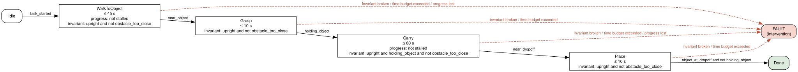
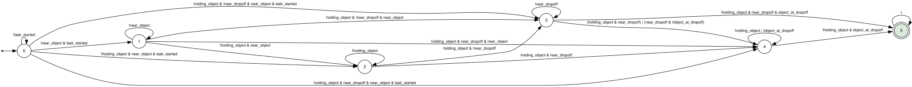

# LTL Skill Monitoring for Humanoids — Status

Pinhas Nehoray Aburmad · supervisor Prof. Ronen Brafman · BGU · October 2026

## 1. Scientific claim

Progress states let a runtime monitor catch skill failures that a flat set of safety rules
misses. A progress state is the semantic phase of a skill (starting, approaching,
confirming), each with its own conditions for entering, progressing and leaving, and its own
time limit.

The test isolates the structure. The generated specification is compared with a control
that has the same propositions, safety rules and end conditions, but its phases merged and
its order removed. Both face the same faults in the same scenarios, and outcomes are judged
from simulator ground truth, so neither arm grades itself. It was run twice.

**E1, a short walk to a goal (1800 episodes).** The structure added **one detection in
fifteen stalls** (15/15 vs 14/15, p = 1.0). What caught stalls was **progress grounded in
odometry**: remove that rule from the control and stall detection falls to 1/15
(p = 2·10⁻⁷). For a two-phase skill, the claim is not supported.

**E1b, fetch and deliver (1440 episodes, over real ROS 2).** Four phases: walk to the
object, grasp, carry, place. The monitor reads only ROS 2 topics (odometry, lidar, the
commanded goal and task, and the object as a detector sees it) and infers from them both
whether the object is held and whether the task succeeded. Here the structure **does**
matter:
- A dropped object is caught in **1 s** by the full spec (the Carry phase requires
  `holding_object`); the flat control notices only when the executor claims success,
  **14 s** later. A failed grasp: **4 s vs 19 s**. Full spec earlier on 20/20 of each,
  never later (sign test p = 1.9·10⁻⁶).
- Re-planning on the early alarm **halves the time to deliver**: 34.5 vs 63 s after a drop,
  36.5 vs 72 s after a failed grasp (20/20 faster, p = 1.9·10⁻⁶).
- **The monitor's own verdict never called a failed task a success** (0 of 104 failed
  episodes, every arm). The full spec ends a failed episode on an explicit FAILURE 71 times
  in 104; the flat spec 22 times, otherwise staying undecided.
- **Final success is the same** (82% vs 84% with re-planning, from 35% without), because
  these faults can be repaired after the fact.

So the supported claim is: **progress states catch phase-specific failures as they happen,
where a flat specification can only notice them at the end.** That turns into a better
outcome when time matters or the failure cannot be undone later. Both experiments also
show that progress must be grounded in sensors, not in the planner.

A supporting claim also holds. The specification was generated from plain language in one
attempt and passed the monitor's own load checks. The monitor reads no planner self-report,
and a test enforces that.

## 2. System setup and status

**How it works.**
1. A plain-language description of a skill is turned by an LLM into an LTL specification:
   phases, safety rules, time limits and failure modes. Spot compiles it into automata.
2. At runtime, an evaluator turns the robot's sensor streams into a fixed vocabulary once per
   tick. The vocabulary is identical on the real G1, MuJoCo and Isaac.
3. The monitor steps the automata and the phase machine and issues one of five
   interventions: continue, warn, re-plan, halt or abort.
4. Progress is measured from odometry against the commanded goal. The monitor reads nothing
   the planner says about itself.

**Test platform.**
- Unitree's 12-DoF G1 in MuJoCo, walking with Unitree's released policy.
- Eight injectable faults, each recorded with the clock tick on which it took effect.
- A deterministic scenario generator.
- An episode runner with three policies:
  - `off` (record only);
  - `detect` (stop at the first intervention);
  - `recover` (re-plan, at most twice).
- Outcomes judged from simulator ground truth.

**E1 setup.**
- **The specification.** Generated from the description by Claude, acting as the describer
  LLM: it was given exactly the describer's prompt. It was accepted on the first attempt and
  committed before any episode ran.
- **Three arms:**
  - `full`: two phases with 15 s and 60 s budgets;
  - `flat`: one phase, budgets summed;
  - `flat strict`: as `flat`, without the terminal-failure rule.
- **The run.** 10 scenario families × 20 seeds × 3 arms × 3 policies = 1800 episodes.
- **What ran headless:**
  - the real evaluator and monitor, with Spot;
  - the MuJoCo G1;
  - a Nav2 stand-in configured from the repository's Nav2 parameters (0.26 m/s), the same
    for every arm.

**E1 results.** Failures caught: faults that made the episode fail under `off`, detected by
each arm.

| Family | Episodes that failed | full | flat | flat strict | Median latency |
|---|---|---|---|---|---|
| push 300 N | 20/20 (fell) | 19 | 19 | 19 | 1 s |
| weaken | 20/20 (fell) | 19 | 19 | 19 | 2 s |
| slip | 11/20 (fell) | 10 | 10 | 10 | 7 s |
| stall | 15/20 (timeout) | **15** | 14 | **1** | 11 s |
| odom drift | 8/20 (false arrival) | 1 | 1 | 1 | — |
| scan dropout | 0/20 | — | — | — | not detected (0/20) |
| obstacle, blocked route | 0/40 | — | — | — | alarms on 35/40 that succeeded |
| clear / cluttered | 0/40 | — | — | — | 3/40 false alarms |

Acting on the monitor lowered success, in every arm alike:
- `off`: 63%;
- `detect`: 43% (−20 pp, p = 9·10⁻⁵);
- `recover`: 52% (−11 pp, p = 0.03).

The cause is the proximity rule (`min_range < 0.3 m`). It fires when the robot passes a
surprise obstacle that the navigator clears safely. Re-planning cannot fix a permanent stall
or a fall.

**E1b setup.** Same pipeline, a longer skill (`sim/e1/carry`).
- **The skill.** Walk to an object, grasp it, carry it 2.5–4 m to a drop-off, put it down.
  The executor is open-loop, as a plain behaviour tree is: it never checks that the grasp
  took. The legs-only G1 has no arm, so a grasp attaches the object within 0.6 m.
- **What the monitor sees: ROS 2 messages only.** The evaluator and the monitor run as
  their own processes on DDS (ROS 2 Humble), as deployed. They subscribe to `/odom`,
  `/scan`, `/goal_pose`, `/task` and `/object/pose` (a perception stand-in: the object's
  position with 2 cm noise and 5% missed detections). No gripper flag, no executor status,
  no simulator state. "Held" is inferred: the object is lifted and within 0.5 m of the
  robot. Success and failure are the monitor's own final verdict, scored against the
  simulator's ground truth, which stays in the driver.
- **The specification.** Generated by Claude as the describer LLM from a new description,
  first attempt, committed before any episode. Four phases: WalkToObject 45 s, Grasp 10 s,
  Carry 60 s (must hold the object), Place 10 s.
- **Control.** One phase whose invariant is only what every phase states (upright, no
  obstacle too close). "Holding the object" cannot be stated without phases.
- **Completion check, every arm.** When the executor reports done, the monitor must confirm
  within 2 s, or the runner intervenes. This is what a flat spec can do; it is the baseline
  to beat.
- **The run.** 8 families (clear, cluttered, grasp fail, drop, skip pick-up, object moved,
  stall, push) × 20 seeds × 3 arms × 3 policies = 1440 episodes, 30 minutes on 4 cores.
  A first run in one process, with the simulator's grasp flag, gave the same headline
  numbers; noise-free, the two transports agree on 18/18 pilot episodes.

**The generated automaton for the task.** The specification Claude generated for E1b
(`skill_monitor/specs/formulas_g1_carry.json`) gives the monitor two things to run. The
figures below are rendered from the monitor's own construction (`core/automata.LTLMonitor`
calls Spot exactly as at runtime: deterministic, complete, state-based Büchi).

*1. The phase machine.* Each phase has an enter and an exit condition, a time budget, a
progress condition and an invariant; breaking any of them is a fault. The Carry invariant,
`holding_object`, is what the flat control cannot express.



*2. The LTL automata*, stepped once per tick on the propositions the evaluator computes from
the ROS messages.

- **Order of the task**, `F(task_started ∧ F(near_object ∧ F(holding_object ∧
  F(near_dropoff ∧ F(object_at_dropoff ∧ ¬holding_object)))))`: 6 states. Each state
  records how far along the task the robot has got (0 = not started, 1 = started,
  2 = at the object, 3 = holding it, 4 = at the drop-off holding it, 5 = delivered,
  accepting).
  Several steps may happen in one tick, hence the edges that skip states.

  

  | state | meaning | stays while | moves to |
  |---|---|---|---|
  | 0 (initial) | task not started | `¬task_started` | 1–4, depending on what already holds |
  | 1 | started, walking to the object | `¬near_object` | 2 (at the object), 3–4 if already holding |
  | 2 | at the object | `¬holding_object` | 3 (holding), 4 (holding and at the drop-off) |
  | 3 | holding, carrying | `¬near_dropoff` | 4 (at the drop-off), 5 (put down at the drop-off) |
  | 4 | at the drop-off | `holding_object ∨ ¬object_at_dropoff` | 5 (object down at the drop-off) |
  | 5 (accepting) | delivered | always | — |

- **Safety failure modes**, `G(upright)` (`fell_over`) and `G(¬obstacle_too_close)`
  (`collision_imminent`): 2 states each. A safe initial state is left for a violating sink
  the first tick the condition fails
  ([`fell_over.svg`](figures/automata/fell_over.svg),
  [`collision_imminent.svg`](figures/automata/collision_imminent.svg)).
- **The flat control** keeps both safety automata but replaces the ordered formula with
  `F(object_at_dropoff ∧ ¬holding_object ∧ upright)`, a 2-state automaton (waiting, then
  accepting). It has one phase whose invariant is only `upright ∧ ¬obstacle_too_close`.

The ordered automaton has no rejecting state: "eventually" can always still come true. A
step that goes wrong (the object dropped while carrying) is caught by the phase machine,
not by the LTL automaton; that division is what the E1b comparison measures. Regenerate:
`python tools/report/render_automata.py skill_monitor/specs/formulas_g1_carry.json --out
docs/figures/automata` (needs Spot and Graphviz).

**E1b results.** Episodes that failed under `off`, caught *during the task* (before the
executor claimed success), and median time to detection:

| Fault | Failed | full | flat | flat strict | Latency full / flat |
|---|---|---|---|---|---|
| drop | 20/20 | **20** | 0 | 0 | **1 s** / 14 s |
| grasp fail | 20/20 | **20** | 0 | 0 | **4 s** / 19 s |
| object moved | 20/20 | **7** | 0 | 0 | 31 s / 32 s |
| skip pick-up | 20/20 | 0 | 0 | 0 | 21 s / 21 s (all at completion) |
| push (fell) | 13/20 | 13 | 13 | 13 | 1 s |
| stall | 11/20 | 11 | 9 | 11 | 11 s (flat strict 106 s) |
| clear / cluttered | 0/40 | — | — | — | 3/40 false alarms, every arm |

With re-planning (`recover`), median seconds to a delivered object: drop **34.5 vs 63**,
grasp fail **36.5 vs 72**, object moved 70 vs 75. Success: full 82%, flat 84%, flat strict
84%, against 35% under `off` (p < 10⁻¹⁷). Where the full spec did worse: nobody catches a
skipped pick-up during the task (progress is "closer to where it walks", not "closer to the
object"), and on slow partial stalls its phase budgets cut off runs that would have
finished late. Over ROS, the flat arm missed 2 of 11 stalls that the in-process run caught:
topics are not ordered against each other, so a slow crawl's debounce can restart, as on a
robot.

**Also done and tested.**
- Falls are physical.
- Reset is bit-identical.
- 1426 monitor tests and 125 simulator tests pass.

Full tables and raw records: [`docs/e1/results.md`](e1/results.md),
[`docs/e1b_ros/results.md`](e1b_ros/results.md) (the first, in-process E1b run:
[`docs/e1b/results.md`](e1b/results.md)); the method:
[`sim/e1/README.md`](../sim/e1/README.md).

**Not done.**
- **The full stack.** E1b ran over real ROS 2, but with the navigator stand-in, not Nav2,
  and without Docker. Docker + Nav2 end to end has not run. E1 ran in one process.
- **One spec per skill.** One generated specification each for two skills.
- **Manipulation is simulated.** The grasp is an attachment (no arm). The object's pose
  comes from a perception stand-in (simulator position plus noise and misses), not a
  camera.
- **The robot.** No G1 runs with TRAV yet; the robot thresholds are uncalibrated.
- **Not started:** a simulated camera, Isaac Sim, and Paper 2.

## 3. Research directions

1. **Turn E1b's latency into outcome.**
   - A deadline, or a failure that cannot be repaired later (a fragile object, a person
     waiting): there detection time is the result.
   - Several specifications generated per skill, to separate the structure from one
     spec's choices.
2. **Fix what E1 and E1b exposed.**
   - Progress relative to the phase's target ("closer to the object"), which would catch
     a skipped pick-up.
   - Re-arm the monitor at the phase the task is in, not at phase one; budgets calibrated
     from nominal runs.
   - Calibrate the proximity rule against the navigator's clearance.
   - Add data-health propositions: a stale lidar must count.
   - Add a position source independent of odometry, to catch drift.
3. **The robot.**
   - Generate the G1 specification.
   - Record runs with TRAV and calibrate the thresholds.
   - Compare navigation success with the monitor on and off.
4. **Paper 2: symbolic structure, learned grounding.**
   - Learned propositions in place of hand thresholds.
   - Anomaly detection conditioned on the current LTL phase.
   - Within budget on the Jetson AGX.

   E1's blind spots (drift, stale sensors) are its motivation.
5. **Later.** Isaac Sim, a real arm, and the specification as a reward machine.

## 4. Try it yourself

You need Linux with `git` and Python 3.10 or newer. No GPU, ROS or Docker is needed. It was
developed on Ubuntu 24.04.

```bash
git clone https://github.com/pinhas019/LtlMonitor.git && cd LtlMonitor
git checkout claude/monitoring-paper-submission-1ryynf
python3 -m venv .venv && . .venv/bin/activate
pip install mujoco "numpy<2" pyyaml pytest matplotlib
sim/fetch_assets.sh /tmp/unitree && export G1SIM_ASSETS=/tmp/unitree

python sim/demo.py                     # stall at t=5 s: no_progress turns TRUE at t=16 s
python sim/demo.py --fault push        # the robot falls: upright = NO
python sim/demo.py --fault none        # healthy walk, never flagged
python -m pytest -q sim/tests          # simulator tests, 1–2 min
python sim/e1/summarize_e1.py <(zcat docs/e1/e1_episodes.jsonl.gz) --out /tmp/e1     # E1 tables from the raw records
python sim/e1/summarize_e1.py <(zcat docs/e1b_ros/e1b_ros_episodes.jsonl.gz) --out /tmp/e1b  # E1b (ROS 2)
```

`demo.py` walks the G1 toward a goal, injects the fault, and passes the robot's odometry
through the monitor's real sensor processing at 1 Hz. Each line it prints shows the time,
the distance to the goal, the closing speed, `no_progress` and whether the robot is upright.

**Re-run E1 or E1b** (needs Spot, which comes from conda-forge; E1 takes about 15 minutes
on 4 cores, E1b over ROS 2 about 30 and also needs ROS 2 Humble, e.g. from RoboStack): see
[`sim/e1/README.md`](../sim/e1/README.md), the "Reproduce" sections.

**With Docker:**

```bash
docker compose -f deploy/docker-compose.test.yml run --rm tests   # the full monitor test suite
docker compose -f deploy/docker-compose.test.yml up console        # web console, mock data: http://127.0.0.1:8799
```
