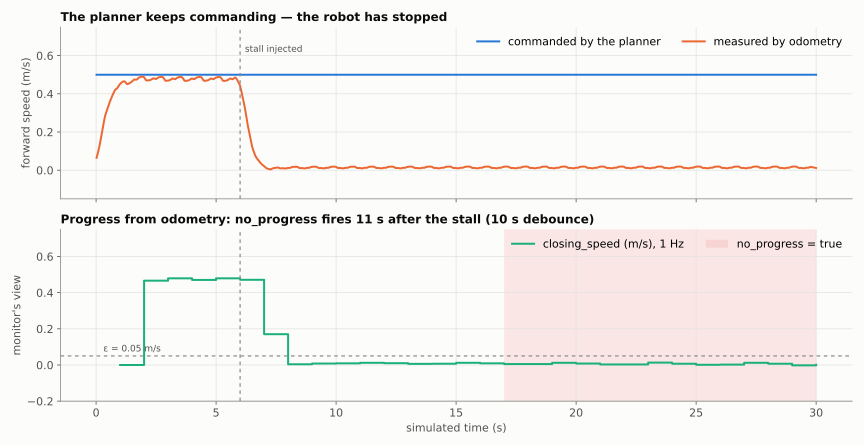

# LTL Skill Monitoring for Humanoids — Status Pitch

Pinhas Nehoray Aburmad · supervisor Prof. Ronen Brafman · BGU · October 2026

## The idea in one paragraph

A robot skill (for example "walk to the goal") is described in plain language. An LLM turns
the description into an LTL specification: *semantic progress states* (phases), safety rules,
timing bounds and failure modes. Spot compiles it into automata. At runtime a monitor reads
the robot's own sensors once per tick and says whether the skill is progressing, stuck or
failing, and what to do: continue, warn, re-plan, halt or abort.

**The claim under test:** progress states catch failures that a flat set of safety rules
misses.

## What has been done

- **A physical simulator.** Unitree's G1 walks under MuJoCo physics with Unitree's own
  walking policy. It can fall and it resets between episodes. Before this, the simulator was
  kinematic and a fall was impossible.
- **Faults with ground truth.** Eight types: push, slip, weaken, stall, surprise obstacle,
  blocked route, odometry drift, lidar dropout. Each records when it took effect, stamped on
  the monitor's clock.
- **Progress from the robot, not the planner.** The monitor no longer reads anything the
  planner says about itself. A test forbids it. Progress is measured from odometry against
  the commanded goal.
- **The experiment pipeline (E1)** is complete:
  - the generated spec versus a control with the phase order removed;
  - policies off / detect / recover (re-plan);
  - outcomes judged from simulator ground truth;
  - a statistics table.
- **Bugs found and fixed on the way:**
  - sensor values were stuck at defaults, because the evaluator never folded them;
  - the robot measured progress against a moving lookahead point.

## Current status and results

**No E1 results yet.** Generating the spec needs the LLM endpoint, and the full ROS stack
has not yet run on the lab machine. All of it is tested here: 1418 monitor tests and 115
simulator tests, green in CI.

What the simulator already shows, one episode each (illustrations, not statistics):

| Fault at t = 3 s | Outcome |
|---|---|
| none | walked 4.1 m |
| push 300 N / slip μ 0.1 / weaken torque ×0.5 | fell |
| stall (legs stop, command continues) | stood still, upright |
| odometry drift 0.1 m/s | kept walking; only the reported pose drifts |

The key demonstration is the stall. The planner keeps commanding 0.5 m/s, and the robot has
stopped. The monitor's `no_progress` fires 11 s later (10 s debounce). A monitor that read
the planner's status would have seen "following" the whole time.



## How the pipeline works

```
description (plain language)
   └─► LLM ─► spec ─► gate: the monitor's own load checks; repair loop; provenance saved
                 └─► flattened control (same spec, phase order removed)

scenario generator (family × seed) ─► simulator + Nav2 ─► evaluator ─► monitor ─► verdict
                                         │                                         │
                                         └── ground truth (fall, true distance) ───┤
                                                                                    ▼
                         runner: off / detect / recover ─► episode records ─► results table
```

1. **Evaluator.** Folds raw ROS topics into a fixed sensor vocabulary each tick. The
   vocabulary is defined in a JSON descriptor per robot, and is identical across the real G1,
   MuJoCo and Isaac.
2. **Monitor.** Steps the automata and the phase machine and publishes a verdict with an
   intervention token.
3. **Runner.**
   - It acts on the token: nothing, stop, or re-plan.
   - It records the outcome from ground truth, so the arm under test cannot grade itself.
4. **Analysis.**
   - Success rates with Wilson intervals.
   - Fisher exact tests against policy `off`.
   - Detection precision, recall and F1 against the injected faults.

## Research directions

1. **Paper 1, "Structure matters"** (E1, RA-L):
   - do progress states improve detection and recovery over a flat spec?
   - is spec generation from plain language reliable?
   - validated on the G1 with the TRAV navigation app.
2. **Paper 2, "Symbolic structure, learned grounding":**
   - learned propositions in place of hand thresholds;
   - anomaly detection conditioned on the current LTL phase, to catch failures nobody wrote
     a rule for;
   - must run in budget on the Jetson AGX.
3. **Later:**
   - Isaac Sim;
   - more skills (pick and place);
   - LTL as a reward machine for the learned policy.

## What will be done next

1. **First run.** Generate the spec, bring the stack up on the lab machine, and run one
   episode per policy.
2. **E1 sweep.**
   - Fault families × 20 seeds × 2 arms × 3 policies.
   - Then the results table.
3. **Robot.**
   - Generate the robot spec.
   - Record a G1 run with TRAV and calibrate the thresholds.
   - Run with the monitor on and off.

## Run it and deploy it

Needs a Linux PC with `git`, Python 3.10+ and, for B–D, Docker with Compose v2. It was
developed on Ubuntu 24.04. A and B should also work on macOS, but this is untested. No GPU is
needed. Clone first:

```bash
git clone https://github.com/pinhas019/LtlMonitor.git && cd LtlMonitor
git checkout claude/monitoring-paper-submission-1ryynf
```

**A. Two-minute demo** (plain Python 3.10+, no ROS, no Docker). The G1 walks, a fault hits,
and the monitor reports:

```bash
python3 -m venv .venv && . .venv/bin/activate
pip install mujoco "numpy<2" pyyaml
sim/fetch_assets.sh /tmp/unitree && export G1SIM_ASSETS=/tmp/unitree
python sim/demo.py                  # stall: no_progress turns TRUE ~11 s after the fault
python sim/demo.py --fault push     # the robot falls: upright = NO
```

**B. Tests and the web console** (Docker only):

```bash
docker compose -f deploy/docker-compose.test.yml run --rm tests   # the full suite
docker compose -f deploy/docker-compose.test.yml up console        # http://127.0.0.1:8799 (mock data)
```

**C. Full simulation stack** (Docker): MuJoCo bridge, Nav2, clock, evaluator and monitor,
running the episode runner.

```bash
SPEC=formulas_g1.json AUTO_GOAL=0 docker compose -f sim/docker-compose.sim.yml up --build
python3 sim/generate_scenarios.py --family clear stall push --seeds 0-4 --out /tmp/scen
python3 -m skill_monitor.backend.ablation_runner --scenario-dir /tmp/scen \
    --arm full --policy recover --out episodes.jsonl      # needs ROS 2 Humble, see below
python3 tools/analyze_episodes.py episodes.jsonl
```

The runner is a ROS node. Run it either:
- on a host with ROS 2 Humble (`source /opt/ros/humble/setup.bash`), or
- inside the evaluator container (`docker exec -it ltl-client bash`), after copying the
  scenarios in with `docker cp`.

For E1 itself, use the generated spec and its flattened control instead of the interim
`formulas_g1.json` (see `sim/README.md`, "Running E1"). This stack has not yet been run end
to end on a real machine; it is the next step.

**D. Real robot and server.** All machines must be on one network with the same
`ROS_DOMAIN_ID`.

```bash
# on the robot: clock, evaluator, monitor, supervisor
docker compose -f deploy/docker-compose.robot.yml up --build
# on the server / PC: second-tier monitor, gateway, console, spec generator
LLM_API_URL=http://<llm-host>/v1 LLM_MODEL=<model> \
    docker compose -f deploy/docker-compose.server.yml up --build
```

Adapters and specs are read from a mounted `config/` folder
(`SKILL_MONITOR_CONFIG_HOST=/path`). To change the robot or the skill, edit JSON; no rebuild
is needed.

To generate a spec from the plain-language description:

```bash
python -m skill_monitor.describer.generate_spec --adapter real_g1 \
    --description skill_monitor/specs/descriptions/g1_navigation.md \
    --out skill_monitor/specs/formulas_g1.json --api-url http://<llm-host>/v1 --model <model>
```

More detail:
- [`sim/README.md`](../sim/README.md): faults, scenarios, running E1.
- [`RESUME.md`](../RESUME.md): the current state and robot notes.
